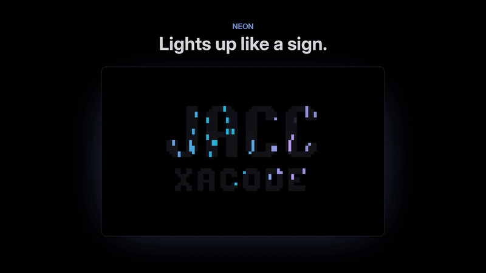

<p>
  <picture>
    <source media="(prefers-color-scheme: dark)" srcset="docs/marca/logotipo.svg">
    
  </picture>
</p>

# omarchy-screensaver-fx

> [!IMPORTANT]
> **Este proyecto se ha trasladado a [screensaver-fx](https://github.com/thealejandro/screensaver-fx).**
> Es el mismo salvapantallas reescrito en Rust para Windows, macOS y Linux (Omarchy),
> con 41 efectos en lugar de 6. Este repositorio queda archivado y ya no se actualiza.
> Para cambiar, ejecuta aquí `./uninstall.sh` y sigue las
> [instrucciones para Omarchy](https://github.com/thealejandro/screensaver-fx/blob/main/README.es.md#linux-omarchy)
> (su instalador también quita los enlaces antiguos). Demo en vivo: <https://thealejandro.dev/screensaver-fx>

[English](README.md)



[Ver el vídeo completo (1 min)](docs/demo-es.mp4) · [Página web](https://thealejandro.dev/omarchy/screensaver)

Más animaciones para el salvapantallas de [Omarchy](https://omarchy.org), sin
reemplazarlo. Conservas todos los efectos de `ttfx` de Omarchy y además:

- **Los mismos efectos con los colores de tu tema.** La mitad de las veces,
  los efectos de `ttfx` se dibujan con los colores de acento del tema de
  Omarchy que tengas activo (aclarados lo justo para leerse sobre negro). Si
  cambias de tema, cambian con él.
- **Seis animaciones propias** que dibujan tu texto del salvapantallas
  (`~/.config/omarchy/branding/screensaver.txt`), siempre centrado:

| Animación | Qué hace |
| --- | --- |
| `neon` | Los trazos se encienden con parpadeos, como tubos de neón, y luego respiran mientras un destello los cruza. |
| `starfield` | Viajas entre estrellas mientras tu texto aparece poco a poco en el centro. |
| `terminal` | Una terminal escribe `whoami` y responde imprimiendo tu texto línea a línea. |
| `glitch` | El texto quieto sufre ráfagas de interferencia digital: desfase RGB, líneas desplazadas y ruido. |
| `plasma` | Un plasma con los colores de tu tema fluye dentro de las letras. |
| `clock` | Tu texto con un reloj grande y la fecha debajo (en español o inglés, según `omarchy language`). |

En cada vuelta hay un 35 % de probabilidad de que salga una animación propia;
si no, se reproduce un efecto de `ttfx`, nunca el mismo dos veces seguidas.
Se cierra con cualquier tecla, como siempre.

## Instalación

```bash
git clone https://github.com/thealejandro/omarchy-screensaver-fx ~/Work/omarchy-screensaver-fx
~/Work/omarchy-screensaver-fx/install.sh
omarchy-launch-screensaver force   # para probarlo
```

El instalador enlaza los archivos del repo en su sitio, así que `git pull` lo
actualiza todo. Si va a sustituir algún archivo, antes hace una copia de
seguridad.

Para desinstalar, `./uninstall.sh`: el salvapantallas vuelve a ser el de
Omarchy. Tu `screensaver.txt` nunca se toca.

## Por qué aguanta las actualizaciones

No copia ni modifica nada de Omarchy:

- `bin/ttfx` envuelve a `ttfx`. Solo actúa cuando lo llama el salvapantallas
  de Omarchy (con `--random-effect` y tu `screensaver.txt`): elige el efecto
  y conserva todas las demás opciones que pasa Omarchy. Cualquier otra
  llamada a `ttfx` pasa intacta. La lista de efectos se lee de `ttfx --help`
  cada vez, así que los efectos nuevos entran solos en la rotación.
- `bin/omarchy-screensaver` espera a que la terminal tenga su tamaño
  definitivo (en algunos equipos el salvapantallas arrancaba antes de tiempo
  y cortaba el texto por la derecha) y luego ejecuta el script de Omarchy,
  sea cual sea su versión.
- Un hook `post-update` ejecuta `screensaver-check.sh` después de cada
  `omarchy update`. Comprueba que Omarchy sigue llamando a `ttfx` igual, que
  los envoltorios van primero en el `PATH`, que `ttfx` sigue admitiendo las
  opciones de color y que todas las animaciones arrancan. Si algo cambió,
  recibes una notificación y queda un registro en
  `~/.local/state/omarchy/screensaver-check.log`. Mientras tanto, el
  envoltorio vuelve al comportamiento original de Omarchy, así que el
  salvapantallas nunca se rompe.

Los dos envoltorios viven en `~/.local/bin`, que debe ir antes que `/usr/bin`
en el `PATH` de Hyprland (así es en una instalación normal de Omarchy; el
instalador avisa si no).

## Ajustes

Al principio de `bin/ttfx`:

```bash
PROB_PROPIAS=35   # % de vueltas con animación propia
PROB_TEMA=50      # % del resto que usa los colores del tema
```

Para ver una sola animación: `python3 screensaver-fx.py plasma` (añade
`--seconds N` para cambiar su duración).

## Texto propio

`examples/generate-screensaver.py` crea un logo de dos líneas (una palabra
grande y otra más pequeña) con letras de bloques dibujadas a mano al estilo
del logo de Omarchy. Viene con `JACC` / `XACODE`: cambia las letras y las
palabras y ejecútalo, o instálalo con `./install.sh --with-generator`.

## Vídeo de demostración

`tools/demo/make_demo.py` graba cada animación en una terminal virtual y
genera el vídeo, el GIF y las capturas de `docs/` (necesita `ffmpeg`,
`rsvg-convert` y un `screensaver.txt`):

```bash
uv run --with pyte --with pillow tools/demo/make_demo.py
```

## Licencia

[MIT](LICENSE)

---

Hecho por [thealejandro](https://thealejandro.dev).
