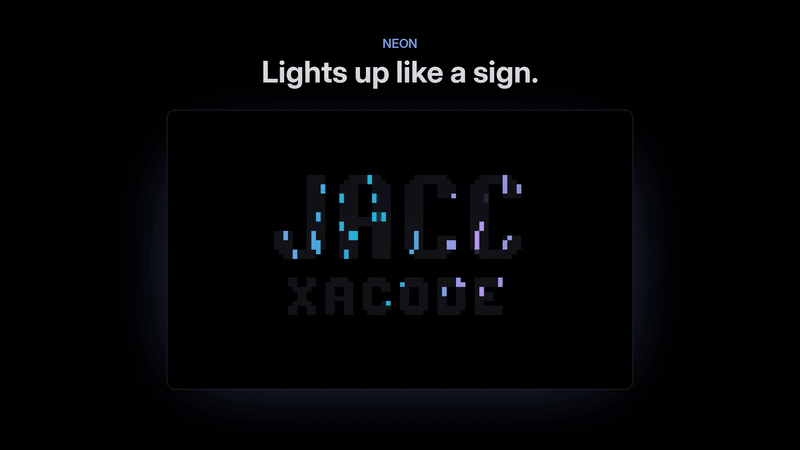

<p>
  <picture>
    <source media="(prefers-color-scheme: dark)" srcset="docs/marca/logotipo.svg">
    
  </picture>
</p>

# omarchy-screensaver-fx

[Español](README.es.md)



[Watch the full video (1 min)](docs/demo-en.mp4) · [Web page](https://thealejandro.dev/omarchy/screensaver)

More animations for the [Omarchy](https://omarchy.org) screensaver, without
replacing it. You keep all of Omarchy's `ttfx` effects and get:

- **The same effects in your theme's colors.** Half of the time, `ttfx`
  effects are drawn with the accent colors of your current Omarchy theme
  (brightened just enough to read on black). Change the theme and they follow.
- **Six original animations** that draw your own screensaver text
  (`~/.config/omarchy/branding/screensaver.txt`), always centered:

| Animation | What it does |
| --- | --- |
| `neon` | Strokes flicker on like neon tubes, then breathe while a shine sweeps across. |
| `starfield` | Fly through the stars while your text fades in at the center. |
| `terminal` | A terminal types `whoami` and answers by printing your text line by line. |
| `glitch` | Steady text hit by bursts of digital interference: RGB split, shifted rows, noise. |
| `plasma` | A plasma in your theme's colors flows inside the letters. |
| `clock` | Your text with a big clock and the date underneath (Spanish or English, following `omarchy language`). |

Each cycle has a 35% chance of an original animation; otherwise it plays a
`ttfx` effect, never the same one twice in a row. Any key closes it, as
usual.

## Install

```bash
git clone https://github.com/thealejandro/omarchy-screensaver-fx ~/Work/omarchy-screensaver-fx
~/Work/omarchy-screensaver-fx/install.sh
omarchy-launch-screensaver force   # try it
```

The installer links the repo files into place, so `git pull` updates
everything. Anything it would overwrite is backed up first.

Uninstall with `./uninstall.sh`: the screensaver goes back to Omarchy's own.
Your `screensaver.txt` is never touched.

## How it stays update-proof

Nothing from Omarchy is copied or edited:

- `bin/ttfx` wraps `ttfx`. It only acts when Omarchy's screensaver calls it
  (with `--random-effect` and your `screensaver.txt`), picks the effect, and
  keeps every other option Omarchy passes. Any other `ttfx` call goes through
  untouched. The effect list is read from `ttfx --help` each time, so new
  effects join the rotation on their own.
- `bin/omarchy-screensaver` waits until the terminal has its final size (on
  some machines the screensaver used to start too early and cut the text on
  the right) and then runs Omarchy's own script, whatever version it is.
- A `post-update` hook runs `screensaver-check.sh` after every
  `omarchy update`. It checks that Omarchy still calls `ttfx` the same way,
  that the wrappers come first in `PATH`, that `ttfx` still supports the
  color options and that every animation starts. If something changed, you
  get a notification and a log in
  `~/.local/state/omarchy/screensaver-check.log`. Meanwhile the wrapper falls
  back to Omarchy's original behavior, so the screensaver never breaks.

Both wrappers live in `~/.local/bin`, which must come before `/usr/bin` in
Hyprland's `PATH` (it does on a default Omarchy install; the installer
warns if not).

## Settings

At the top of `bin/ttfx`:

```bash
PROB_PROPIAS=35   # % of cycles with an original animation
PROB_TEMA=50      # % of the rest that use your theme's colors
```

Run a single animation: `python3 screensaver-fx.py plasma` (add
`--seconds N` to change its length).

## Custom text

`examples/generate-screensaver.py` builds a two-line logo (a big word and a
smaller one) with hand-drawn block letters in Omarchy's logo style. It ships
with `JACC` / `XACODE`; edit the glyphs and words and run it, or install it
with `./install.sh --with-generator`.

## Demo video

`tools/demo/make_demo.py` records every animation in a virtual terminal and
builds the video, the GIF and the screenshots in `docs/` (it needs `ffmpeg`,
`rsvg-convert` and a `screensaver.txt`):

```bash
uv run --with pyte --with pillow tools/demo/make_demo.py
```

## License

[MIT](LICENSE)

---

Made by [thealejandro](https://thealejandro.dev).
